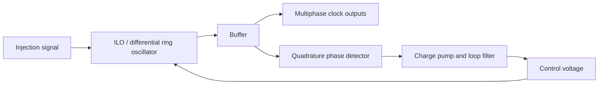

# QLL Design

Design and simulation of an injection-locked quadrature clock in a TSMC 65 nm design environment.

## Scope

The design includes a two-stage differential ring oscillator, oscillator bias circuitry, injection and dummy circuits, a buffer, a quadrature phase detector (QPD), and a charge pump with a loop filter. The documented operating point is approximately 16 GHz.

## Circuit Architecture

| Block | Design work |
| --- | --- |
| Injection-locked oscillator (ILO) | Two-stage differential ring oscillator with bias, injection, and dummy circuits |
| Injection and dummy circuits | Injection-device revision from nch_dnw to nch_lvt_dnw |
| Buffer | Reduced capacitive loading on the oscillator; evaluated output swing, delay, and high-frequency attenuation |
| QPD | XOR-based quadrature phase detection |
| Charge pump and loop filter | Feedback path that converts the phase-detector response into a control voltage |

## Simulation and Calculation Results

These values are recorded in the source presentations for their respective operating conditions. They are simulation and calculation results, rather than silicon measurements.

| Parameter | Recorded value | Conditions / interpretation |
| --- | --- | --- |
| Center frequency | Approximately 16 GHz | Operating point for injection-locking analysis |
| Oscillator current | 4.8050 mA | Used in the injection-strength calculation |
| Injection current | 0.4227 mA | Injection strength k = Iinj / Iosc ≈ 0.0880 |
| Locking range | 15.2962–16.7038 GHz | Injection ON, feedback loop OFF |
| Full locking bandwidth | Approximately 1.4075 GHz | Value reported in the presentation; displayed endpoints differ slightly due to rounding |
| Estimated loop bandwidth | Approximately 164.93 kHz | First-order approximation from the 63.2% control-voltage response; τ ≈ 0.965 µs and BW = 1/(2πτ) |
| Output frequency | 16.0011 GHz | Period: 62.4956 ps |
| Maximum absolute quadrature phase error | 1.689° | Calculated from adjacent edge intervals using QPE = 360 × Δt/T − 90° |

Mean quadrature phase error (MQPE) was modeled against natural oscillation frequency and injection strength. Process-corner behavior and device-noise contributions were also examined. The phase-noise, power, and FoM table requires confirmation of the observation node and injection/feedback conditions before use in performance comparisons.

## Design Review

- Investigated changes in locking range with oscillator bias current.
- Examined the contribution of NMOS flicker noise.
- Evaluated delay and high-frequency attenuation as buffer stage count increased.
- Reviewed sensitivity to QPD/charge-pump mismatch and the available control-voltage range.

## Related Project

[VCO Design](https://github.com/mnju33/VCO-Design) — differential MIM capacitor bank design and EMX verification.
