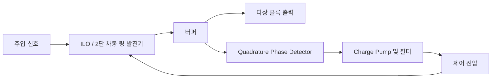

# QLL & VCO Design

QLL 주입 동기 다상 클록과 MIPI 디스플레이 인터페이스용 VCO의 설계 내용을 정리한 저장소입니다.

## 설계 범위

| 구분 | 설계 내용 | 확인 범위 |
| --- | --- | --- |
| QLL | 2단 차동 링 발진기 기반 ILO, 바이어스, 주입·더미 회로, 버퍼, QPD, Charge Pump 및 필터 | 회로 설계 및 시뮬레이션 |
| VCO | 차동 MIM Capacitor Bank의 소자 선정, 15·31·63단 구성, PCell 레이아웃, 핀·배선·접지 구조 | 레이아웃 검증 및 EMX 추출 진행 |

측정 실적이나 전체 VCO의 최종 성능으로 확대 해석하지 않습니다.

## 1. QLL — 주입 동기 다상 클록

### 설계 목적 및 구성

TSMC 65 nm 설계 환경에서 주입 동기 발진기와 위상 보정 루프를 구성하고, 약 16 GHz 동작점에서 다상 클록의 위상 오차와 동기 범위를 확인했습니다.

- **ILO:** 2단 차동 링 발진기, 바이어스 전류 회로, 주입 회로 및 더미 회로로 구성.
- **주입·더미 회로:** 주입 소자를 nch_dnw에서 nch_lvt_dnw로 변경한 설계 수정 기록.
- **버퍼:** 발진기에 보이는 부하 용량을 줄이는 방향으로 설계. 다단 구성의 출력 스윙과 지연·고주파 감쇠를 검토.
- **QPD:** XOR 기반 Quadrature Phase Detector.
- **Charge Pump 및 필터:** 위상 검출 결과를 제어 전압으로 변환하는 피드백 경로.

### 동작 흐름

### 자료에 기록된 시뮬레이션 및 계산 결과

아래 값은 발표자료의 해당 동작 조건에 대한 결과이며, 실측값이 아닙니다.

| 항목 | 기록값 | 조건·해석 |
| --- | --- | --- |
| 중심 주파수 | 약 16 GHz | 주입 동기 범위 검토 동작점 |
| 발진기 전류 / 주입 전류 | 4.8050 mA / 0.4227 mA | 주입 강도 k = Iinj / Iosc ≈ 0.0880 |
| 동기 범위 | 15.2962–16.7038 GHz | Injection ON, loop OFF 조건에서 기록된 범위 |
| 전체 동기 대역폭 | 약 1.4075 GHz | 자료 기재값; 표시된 경계값의 반올림 차이 존재 |
| 루프 대역폭 추정 | 약 164.93 kHz | 제어 전압의 63.2% 응답, τ ≈ 0.965 µs에 1/(2πτ) 적용한 1차 응답 근사 |
| 출력 주파수 | 16.0011 GHz | 주기 62.4956 ps |
| 최대 절대 직교 위상 오차 | 1.689° | 인접 위상 간 시간차로 360×Δt/T−90° 계산 |

MQPE의 자연 주파수 및 주입 강도 의존성을 모델링하고, 공정 코너별 동작과 소자 잡음 기여를 검토했습니다. 위상 잡음·전력·FoM 표는 측정 노드와 주입·루프 조건을 함께 재확인한 후 성능 비교에 사용해야 합니다.

### 설계 검토 사항

- 바이어스 전류 변화에 따른 동기 범위 변화.
- NMOS 플리커 잡음의 기여.
- 버퍼 단수 증가에 따른 지연 및 고주파 감쇠.
- QPD·Charge Pump 불일치와 제어 전압 범위가 동작에 미치는 영향.

## 2. VCO — MIM Capacitor Bank 설계

### 설계 목적

MIPI 디스플레이 인터페이스를 위한 광대역 저지터 VCO 연구에서 주파수 조정용 Capacitor Bank를 설계했습니다. 이 문서의 VCO 범위는 연구노트로 확인된 Capacitor Bank 설계이며, 전체 VCO 설계 완료를 의미하지 않습니다.

### Bank 구성 및 소자 선정

- 단일 MIM capacitor 1,088개 치수 후보의 추출 결과를 바탕으로 설계.
- 단일 캡의 9 GHz Q가 높은 순으로 후보를 검토하고, 이미 선택한 캡과 C 차이가 0.5 fF 이내인 후보를 건너뛰어 199개 치수 선정.
- 한쪽 15·31·63개, 차동 양쪽 합계 30·62·126개로 구성.
- 199개 치수 × 3가지 크기 = 총 597개 Bank.
- oscp·oscm 공통 단자와 capp·capm 개별 탭 구성.

### PCell 레이아웃

| 항목 | 설계 내용 |
| --- | --- |
| 소자 | tsmcN65/mimcap_um_rf PCell |
| 배치 | 행마다 좌우 capacitor 각 1개 |
| 좌우 캡 중앙 M8 간격 | 1.50 µm |
| 바깥 M9 행 간격 | 0.84 µm |
| 행별 핀 순서 | oscp[i] → capp[i] → capm[i] → oscm[i] |
| 핀 접근 방향 | oscp 왼쪽, capp 오른쪽, capm 왼쪽, oscm 오른쪽 |
| osc 핀 | M9 크기에 맞춘 M8/pin |
| cap 핀 | 돌출 M8 부분 |
| 비아 | 소자 치수에 따라 크기 및 M9–M8 컷 수 조정 |
| 접지 | 좌우 vssa M5 접점 각 1개, 모든 BULK를 공통 M5로 연결 |

### 구조 수정 및 검증

초기 레이아웃의 라벨 위치와 실제 핀 객체 문제를 확인하여, 도형 중심 구조를 실제 MIM PCell과 핀 객체를 갖는 구조로 재작성했습니다.

- 기본 layout 597개에 대해 PCell 43,382개, 21,691개 행의 간격과 핀 순서를 검증.
- M8/pin 86,764개의 순서를 확인하고, 접촉부당 M9–M8 비아 18–36컷을 기록.
- layout 및 layout_mim_v2 두 뷰를 검사.
- 연구노트의 최종 핀 재조정 기록은 1,194개 뷰 중 1,193개 수정·검증 완료로 기재되어 있어, 남은 잠금 뷰의 반영 상태를 최종 확인할 필요가 있음.

### EMX 검증 상태

초기 추출에서 P/M 포트 위치 및 접지 접점 차이가 Q 비교에 영향을 주는 것으로 분석했습니다. **핀 수정 전 C·Q는 참고 데이터로만 취급**하며, 수정한 레이아웃의 최종 성능으로 제시하지 않습니다.

수정 구조의 검증 항목:

1. 검증된 최신 GDS와 포트 정의의 일치 확인.
2. 대표 셀에서 라벨 중심 1 × 1 µm 주입 포트와 핀 속성을 포함한 포트 비교.
3. 메시 조건별 9 GHz C·Q 수렴 확인.
4. P/M 대칭 조건과 위치별 저항 비교.
5. 검증 조건 확정 후 597개 Bank 재추출 및 설계 계산기 반영.

## 자료 근거

- QLL__pll.pptx: 회로 구성, 주입 동기 범위, 루프 응답, 직교 위상 오차.
- QLL.pptx 및 QLL_past.pptx: 회로 수정 및 잡음·버퍼 검토 기록.
- [VCO 주간 연구노트 W11](https://docs.google.com/spreadsheets/d/10oYxRaVc69ShrGxXwJi_bWyr5pR38Fh5EPvvSAdEf2o/edit#gid=340642055): Capacitor Bank 설계·재작성·검증 상태.

발표자료의 논문 소개와 실제 구현을 구분하고, 자료에서 확인되는 직접 설계 범위만 정리했습니다. 원본 PDK·회로 데이터와 발표 파일은 이 저장소에 포함하지 않았습니다.
